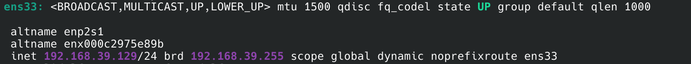
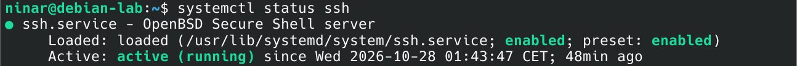
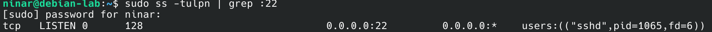
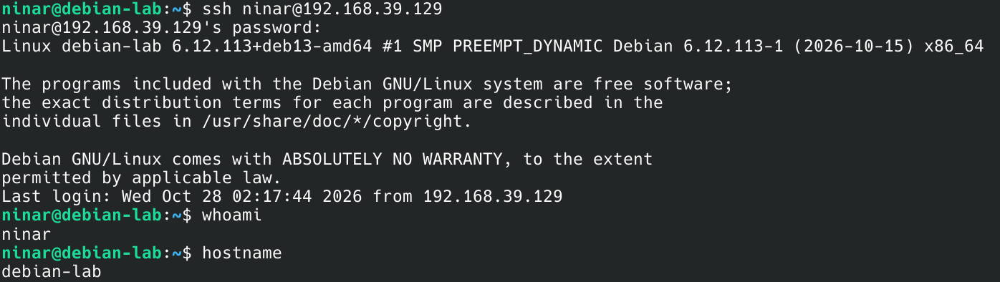

# Laboratoire Linux et réseau

Ce projet me permet de pratiquer la configuration d’un environnement Linux virtualisé et les bases du réseau.

## Configuration de Debian

J’ai installé Debian sur VMware Workstation et configuré la machine virtuelle avec un réseau en mode NAT.

### Réseau

L’interface réseau utilisée est `ens33`.

La machine virtuelle a reçu automatiquement une adresse IPv4 via DHCP :

```text
192.168.39.129/24
```

J’ai vérifié la configuration avec :

```bash
ip a
```



### SSH

J’ai installé OpenSSH Server afin de pouvoir me connecter à Debian à distance.

J’ai vérifié l’état du service avec :

```bash
systemctl status ssh
```

Le service SSH est actif et activé au démarrage.



J’ai ensuite vérifié que SSH écoute sur le port 22 :

```bash
sudo ss -tulpn | grep :22
```



Enfin, j’ai testé une connexion SSH avec :

```bash
ssh ninar@192.168.39.129
```

La connexion a fonctionné correctement.



## Outils utilisés

- VMware Workstation
- Debian
- OpenSSH
- Linux terminal

## Suite du projet

La prochaine étape consiste à ajouter une machine Parrot OS au laboratoire afin de tester la communication entre les machines et d’effectuer des analyses réseau avec Nmap et Wireshark.