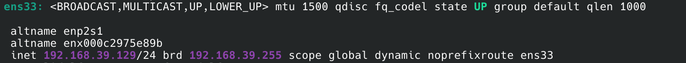
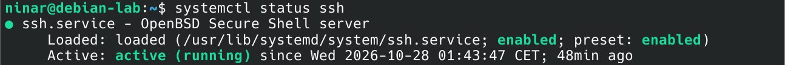
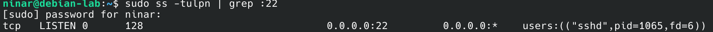
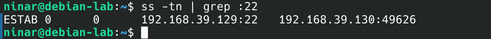
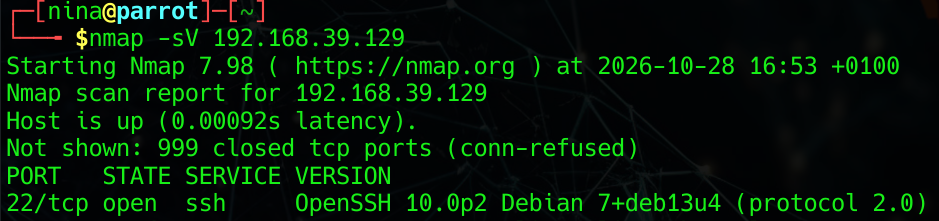
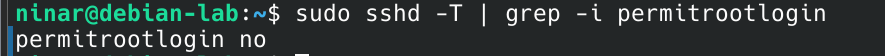
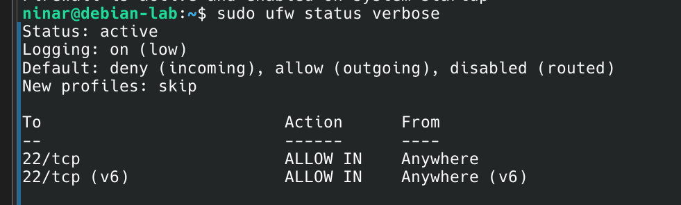
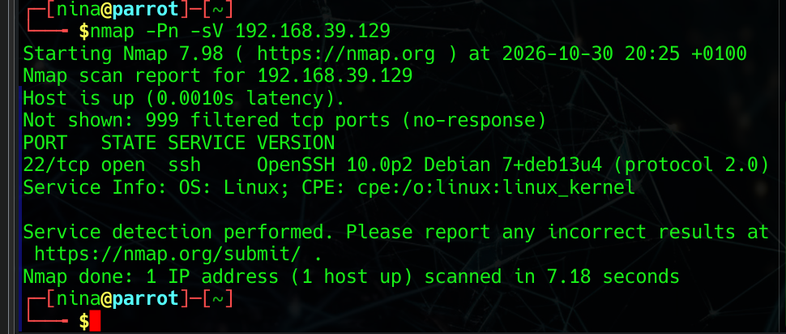
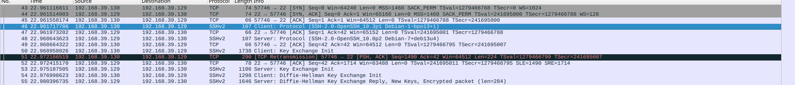

# Linux Network Security Lab

Petit laboratoire réalisé avec Debian et Parrot OS sous VMware.

Le but était de tester la communication entre deux machines Linux, utiliser SSH, faire des scans avec Nmap, sécuriser Debian et observer le trafic avec Wireshark.

## Environnement

- Debian : `192.168.39.129`
- Parrot OS : `192.168.39.130`
- Réseau VMware : NAT
- Interface réseau principale : `ens33`

## 1. Configuration réseau de Debian

Pour vérifier l’adresse IP et l’état de l’interface réseau :

```bash
ip a
```

Debian utilise l’adresse :

```text
192.168.39.129/24
```



## 2. Service SSH

Pour vérifier que le serveur SSH est actif :

```bash
systemctl status ssh
```

Le service était :

```text
active (running)
```



Pour vérifier que le port SSH est en écoute :

```bash
sudo ss -tulpn | grep :22
```



## 3. Connexion SSH depuis Parrot

Depuis Parrot OS :

```bash
ssh ninar@192.168.39.129
```

La connexion a fonctionné correctement.



Sur Debian, j’ai aussi vérifié la connexion TCP active avec :

```bash
ss -tn | grep :22
```

## 4. Scan Nmap avant sécurisation

Depuis Parrot :

```bash
nmap -sV 192.168.39.129
```



Résultat principal :

```text
22/tcp open ssh
999 ports TCP fermés
```

L’option `-sV` permet d’identifier le service et sa version.

## 5. Sécurisation de SSH

La connexion SSH directe avec le compte root a été désactivée :

```text
PermitRootLogin no
```

La configuration SSH a été vérifiée avec :

```bash
sudo sshd -t
```

Puis le service SSH a été rechargé.



La connexion avec un utilisateur normal reste possible.

## 6. Pare-feu UFW

UFW a été configuré pour :

- bloquer les connexions entrantes par défaut ;
- autoriser les connexions sortantes ;
- autoriser SSH sur le port `22/TCP`.



## 7. Scan Nmap après sécurisation

Après l’activation du pare-feu :

```bash
nmap -Pn -sV 192.168.39.129
```



Résultat principal :

```text
22/tcp open ssh
999 ports TCP filtered
```

Avant le pare-feu, les ports non utilisés apparaissaient comme `closed`.

Après la sécurisation, ils apparaissent comme `filtered`.

L’option `-Pn` permet de lancer le scan même si les tests de découverte de l’hôte sont filtrés.

## 8. Analyse avec Wireshark

J’ai capturé le trafic SSH entre Parrot et Debian.

Filtre utilisé :

```text
tcp.port == 22
```



On peut voir :

- le handshake TCP : SYN, SYN/ACK, ACK ;
- le début de la connexion SSH ;
- l’échange de clés ;
- le trafic chiffré.

## Outils utilisés

VMware Workstation, Debian, Parrot OS, SSH, Nmap, Wireshark, UFW, Git et GitHub.